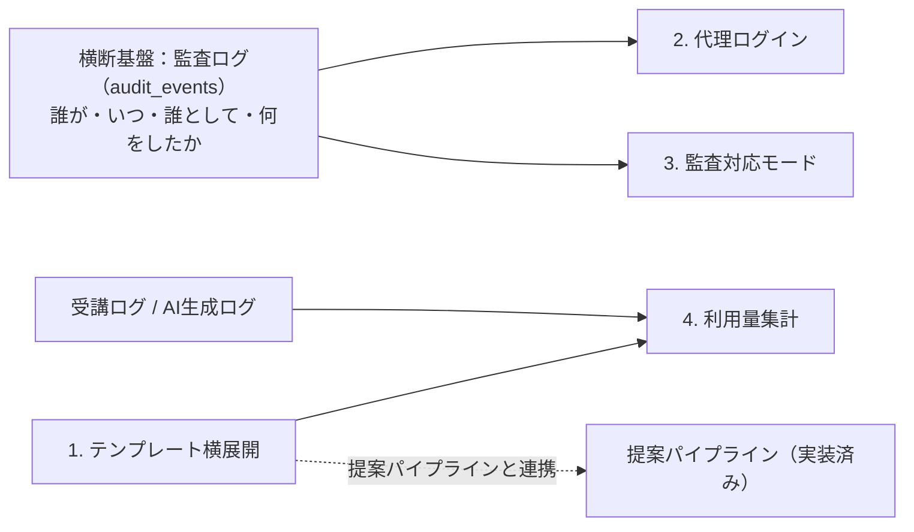
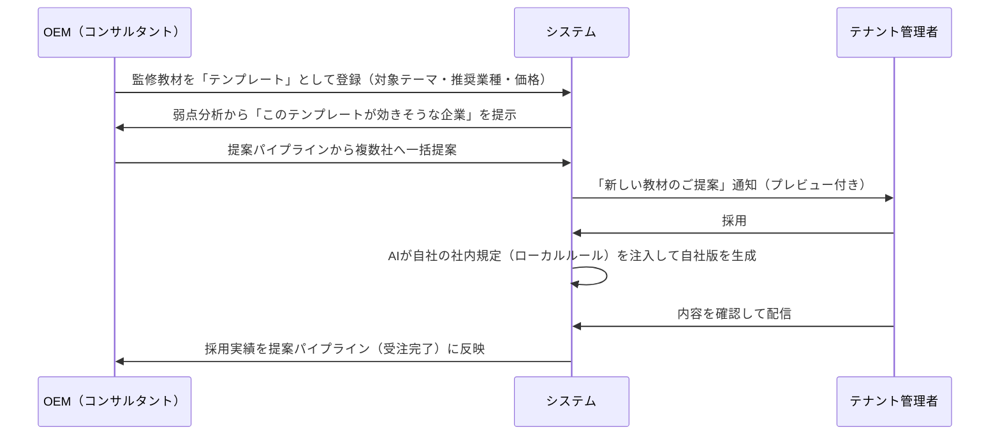
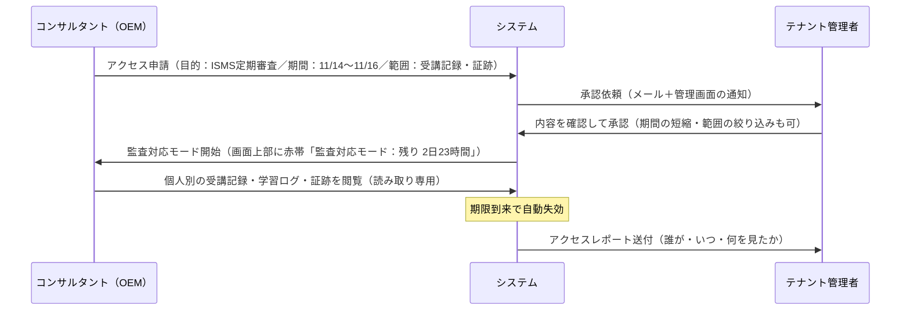

# ISMS教育資料管理ツール 追加開発・検討メモ（ロードマップ）

| 項目       | 内容                                                                         |
| ---------- | ---------------------------------------------------------------------------- |
| 文書の位置 | 追加開発の構想メモ（要件確定前のたたき台）                                   |
| 前提文書   | [`SAAS_ARCHITECTURE_DESIGN.md`](./SAAS_ARCHITECTURE_DESIGN.md)（基本設計書） |
| 対象       | 現行プロトタイプ（OEM / テナントの2モード構成）の次の開発テーマ              |
| 作成日     | 2026-10-17                                                                   |

---

## 0. 全体像

| #   | テーマ                                   | 主な利用者          | ねらい                     | 着手条件                           | 優先度 |
| --- | ---------------------------------------- | ------------------- | -------------------------- | ---------------------------------- | ------ |
| 1   | 監修教材のテンプレート化と横展開         | OEM → テナント      | 提案単価と提案数を伸ばす   | **青木様との知財・収益配分の合意** | 高     |
| 2   | 代理ログイン（Impersonation）            | OEM（サポート担当） | 問い合わせ対応を早くする   | 監査ログ基盤（§横断）              | 中     |
| 3   | 監査対応モード（一時アクセス申請・承認） | OEM ⇄ テナント      | 審査業務をシステム内で完結 | 監査ログ基盤・テナント承認フロー   | 高     |
| 4   | 利用量（MAU / AIクレジット）集計         | OEM（請求担当）     | 請求根拠を自動で揃える     | 受講ログ・AI生成ログの記録         | 中     |



**進め方の提案**：テーマ2・3はどちらも「OEMがテナントの領域に一時的に入る」機能で、監査ログ・期限・警告表示の仕組みを共有できます。**先に共通基盤（監査ログ）を作り、3 → 2 の順に載せる**のが効率的です。テーマ1は合意形成に時間がかかるため、**青木様への相談を開発と並行して先に始める**ことを推奨します。

---

## 1. 監修教材のテンプレート化と横展開（※青木様への事前相談・合意事項）

### 1.1 背景

- 現在、OEM（監査事業会社）が作った良質な教材は、作成した1社への配信で終わっている。同じ弱点（例：標的型メール）を抱える他社にも有効なのに、**毎回ゼロから作り直している**。
- 統括ダッシュボードの弱点分析と提案パイプラインはすでに稼働しており、「どの会社に・どのテーマを提案すべきか」は見えている。**提案に添える教材**が揃えば、提案から受注までが短くなる。

### 1.2 機能の概要

OEMが作成した教材を「テンプレート」としてストックし、提案パイプライン経由で他テナントへ一括提案・横展開する。テナントが採用すると、**AIがその企業の社内規定を自動注入**し、各社専用の教材としてローカライズされる。



### 1.3 実装構想

| 区分         | 内容                                                                                                                                                                                     |
| ------------ | ---------------------------------------------------------------------------------------------------------------------------------------------------------------------------------------- |
| OEM画面      | 「監修教材ライブラリ」に **テンプレート化** ボタンを追加。テンプレート一覧（採用社数・採用率）を表示                                                                                     |
| 提案連携     | 提案パイプラインのカードに「添付テンプレート」を持たせ、複数社へ一括で「提案中」に移せるようにする                                                                                       |
| テナント画面 | 「教材ライブラリ」に **ご提案中の教材** セクション。プレビュー → 採用 → 自社版生成 → 配信の流れ                                                                                          |
| ローカライズ | 既存の「教材をつくる」の社内規定ハイブリッド適用（`getTenantPolicy`）を流用。テンプレート本文 ＋ 自社規定 → 自社版                                                                       |
| データ       | 基本設計書 §4.5 の3階層（標準 → 監修 → 自社版）に沿い、`source_type` / `source_id` / `source_version` で**系譜**を保持。テンプレート更新時は下流へ「更新あり」を通知（自動上書きしない） |

### 1.4 検討事項：知財の分離（実装前に青木様と合意する）

教材が3段階で作られるため、**どの段階の成果物が誰のものか**を先に決めておく必要があります。

| 成果物                     | 作成者                      | 想定する帰属         | 理由・論点                                                                                       |
| -------------------------- | --------------------------- | -------------------- | ------------------------------------------------------------------------------------------------ |
| ① 標準教材（IPA準拠など）  | プラットフォーム            | **プラットフォーム** | 全パートナー共通の土台。パートナーには利用許諾のみ                                               |
| ② テンプレート（監修教材） | OEM（監査事業会社）         | **OEM**              | 監修ノウハウそのもの。他パートナーには見せない。契約終了時の扱い（持ち出し可否）を決める必要あり |
| ③ 自社版教材（最終出力）   | AI（②＋テナントの社内規定） | **テナント**         | 社内規定という**機密情報を含む**ため。OEMによる再利用・他社転用は不可                            |

**合意が必要な論点**

1. **③の再利用範囲**：テナント帰属とした場合でも、OEMが「改善のヒント」として閲覧できるか（できる場合はテナントのオプトインを必須にする。社内規定画面の共有トグルと同じ考え方）。
2. **マネタイズ方針**：テンプレートの採用を、(a) プランに含める、(b) 1テンプレートごとの追加料金、(c) 追加コンサル契約の一部として扱う、のどれにするか。
3. **収益配分**：(b) の場合、プラットフォームとOEMの配分率。プラットフォーム側のAI生成原価をどう載せるか。
4. **契約終了時の扱い**：OEMとの契約が終わった場合、テナントに配信済みの③は引き続き利用できるか（**証跡の継続性の観点から、利用継続を推奨**）。
5. **表示**：自社版教材に「〇〇監修」のクレジットを残すか。

> ⚠️ 上記が合意されるまでは、テンプレート機能は**実装に着手しない**。合意内容は利用規約・OEM契約書に反映する。

---

## 2. 顧客サポートのための「代理ログイン（Impersonation）」

### 2.1 背景

- テナントからの問い合わせ（「配信設定のやり方がわからない」「受講者が表示されない」など）に対し、現状は画面共有や口頭説明に頼るしかない。
- OEMの画面からはテナントの画面が**見えない**（意図どおりの分離設計）ため、コンサルタントが状況を再現できない。

### 2.2 機能の概要

コンサルタントが一時的に「顧客の管理者」としてシステムに入り、操作を代行・確認する。

### 2.3 UI要件

- 代理ログイン中は、**画面上部に警告帯を常時表示**する（スクロールしても消えない）。

  ```
  ┌──────────────────────────────────────────────────────────────────────┐
  │ ⚠ ※現在、株式会社スマートフロー として代理ログイン中です（残り 28分） [終了する] │
  └──────────────────────────────────────────────────────────────────────┘
  ```

- 警告帯は通常のテナント画面と明確に区別できる色（例：オレンジ）にし、サイドバーのアカウント欄も「代理：山田（E&N）」と表示する。
- 「終了する」で即座にOEM画面へ戻る。

### 2.4 実装構想

| 区分           | 内容                                                                                                                                                                                             |
| -------------- | ------------------------------------------------------------------------------------------------------------------------------------------------------------------------------------------------ |
| 開始           | 「顧客・アカウント管理」の各行に **代理ログイン** ボタン。理由（問い合わせ番号など）の入力を必須にする                                                                                           |
| セッション     | 現行の `Session` 型に `impersonator`（実際に操作している人）を追加し、`{ mode: "tenant", tenantId, impersonator: { userId, name, expiresAt } }` とする。画面側は既存のテナントUIをそのまま使える |
| 有効期限       | 30分で自動失効（延長は再開始）                                                                                                                                                                   |
| 操作制限       | 誤操作・悪用を防ぐため、代理中は以下を**不可**にする：社内規定の削除、受講者の削除、証跡PDFの発行、OEMへの閲覧許可の切り替え（テナント本人の意思表示であるべき操作）                             |
| 記録           | 開始・終了・すべての更新操作を `audit_events` に「`actor`（実際の操作者）／`on_behalf_of`（なりすまし先）」の両方で記録する                                                                      |
| テナントの同意 | テナント側に「サポート用の代理ログインを許可する」設定（初期値：OFF）を設ける。代理ログインが行われたら、テナント管理者へ通知し、操作履歴を後から確認できるようにする                            |

### 2.5 検討事項

- **テナントの事前同意を「毎回」にするか「包括（設定ON）」にするか**。運用負荷とのバランスで決める。プレミアムプランのみ包括可、なども考えられる。
- 代理中に**個人単位の受講データ**が見えてしまう点。テーマ3（監査対応モード）との棲み分けとして、代理ログイン中は個人名をマスクする案もある。

---

## 3. 審査本番用の「監査対応モード（一時アクセス申請・承認）」

### 3.1 背景

- ISO審査・Pマーク審査では、「誰が・いつ・何点で受講したか」という**個人単位の受講記録**を確認する場面がある。
- 一方で、OEMが常にテナントの個人データを見られる状態は、個人情報保護の観点から望ましくない。現行プロトタイプでも、OEMには**集計値のみ**を見せる設計にしている。

### 3.2 機能の概要

コンサルタントが、個人単位の受講ログ（詳細データ）を確認するためのアクセス権を、**システム上でテナントへ申請**する。

### 3.3 セキュリティ・コンプライアンス方針

| 原則             | 内容                                                                                  |
| ---------------- | ------------------------------------------------------------------------------------- |
| **オプトイン**   | テナントが承認しない限り、個人データは見えない                                        |
| **期間限定**     | テナントが承認した期間のみ有効（最長14日）。期限が来たら自動で失効                    |
| **読み取り専用** | 閲覧のみ。編集・削除は不可。出力は証跡PDFのみ（「監査対応モードで出力」の透かし入り） |
| **範囲指定**     | 受講記録 ／ 証跡 ／ 社内規定 から、必要な範囲だけを申請・承認する                     |
| **透明性**       | 誰が・いつ・何を見たかをすべて記録し、テナントがいつでも確認できる                    |

### 3.4 画面の流れ



### 3.5 実装構想

| 区分         | 内容                                                                                                                                                              |
| ------------ | ----------------------------------------------------------------------------------------------------------------------------------------------------------------- |
| OEM画面      | 「監査スケジュール」の各社の審査予定から **アクセス申請** を起票できるようにする（審査日に合わせて期間を自動入力）                                                |
| テナント画面 | 「証跡・記録」に **監査アクセス申請** タブ。承認／拒否／期間短縮、過去のアクセス履歴を表示                                                                        |
| データ       | `audit_access_sessions`（申請者・テナント・範囲・開始/終了・状態）を新設。RLSで「承認済み・期間内・範囲内」のときだけ個人データの参照を許可（基本設計書 §4.7 L4） |
| 画面表示     | 監査対応モード中は赤帯を常時表示（代理ログインの警告帯と共通コンポーネント化）                                                                                    |
| 自動承認     | テナントの任意設定として「登録済みの審査期間中は自動承認」を用意（毎回の承認が負担な企業向け）                                                                    |

### 3.6 検討事項

- **代理ログインとの違いを明確にする**：代理ログインは「操作の代行（短時間）」、監査対応モードは「閲覧のみ（審査期間）」。権限の大きさが違うため、承認の要否・期間・記録内容を分けて設計する。
- 審査員（第三者の審査機関）にも見せる必要がある場合、**審査員用の閲覧専用アカウント**を発行するかどうか。

---

## 4. 請求管理のための「利用量（MAU / AIクレジット）集計」

### 4.1 背景

- OEMは各テナントへ月額費用や従量課金を請求するが、現状は根拠となる数字を手作業で集める必要がある。
- 基本設計書 §1.3 の料金設計では、プラットフォーム → OEM の卸売価格を **MAU（当月のアクティブ受講者数）と AI 生成回数** で算出する。OEM → テナントの請求にも同じ数字を使えると、請求の説明がしやすい。

### 4.2 集計対象

| 指標                | 定義                                                        | 備考                                               |
| ------------------- | ----------------------------------------------------------- | -------------------------------------------------- |
| **MAU**             | 当月に1回以上、受講ポータルにアクセスした受講者のユニーク数 | 「登録者数」ではない。招待中・無効の社員は含めない |
| **AI 教材生成回数** | 当月に「教材をつくる」でAI生成を実行した回数                | 再生成も1回と数える                                |
| **AI 規定解析回数** | 当月に社内規定PDFをアップロードし、AIが解析した回数         | 原価が大きいため生成回数と分けて集計               |
| （参考）登録社員数  | 月末時点の登録者数                                          | 受講者管理画面の数字と一致                         |

### 4.3 UI要件

- 「顧客・アカウント管理」の一覧に、**当月MAU**・**AI生成回数**の列を追加する（プランの上限に対する使用率をバーで表示）。
- 画面上部に **対象月の選択** と **CSVエクスポート** ボタンを置き、月次の請求データとして出力できるようにする。
- 上限超過が近いテナントには注意表示を出す（アップセル提案のきっかけにもなる）。

### 4.4 実装構想

| 区分 | 内容                                                                                                                                      |
| ---- | ----------------------------------------------------------------------------------------------------------------------------------------- |
| 記録 | 受講ポータルへのアクセス（マジックリンク経由を含む）と、AI生成・解析の実行を `usage_events` に記録する（`tenant_id`・種別・日時・実行者） |
| 集計 | 月次バッチで `usage_monthly`（テナント × 月 × 指標）を作成。**締め後の月は確定値として固定**し、後から変わらないようにする                |
| 出力 | CSV（Excel で開けるよう UTF-8 BOM 付き）と、n8n 連携用の Webhook（`usage.monthly_closed`）の2系統                                         |
| 権限 | OEMは自社が担当するテナントの集計値のみ。個人名は含めない（MAU は人数のみ）                                                               |

### 4.5 出力データ（案）

CSV の列と n8n 連携用 JSON は、同じフラットな構造（snake_case）にそろえます。

| 列名                 | 内容                       |
| -------------------- | -------------------------- |
| `billing_month`      | 対象月（YYYY-MM）          |
| `tenant_id`          | テナントID                 |
| `tenant_name`        | 企業名                     |
| `plan_code`          | 利用プラン                 |
| `registered_members` | 月末時点の登録社員数       |
| `mau`                | 当月アクティブ受講者数     |
| `ai_generations`     | AI 教材生成回数            |
| `ai_policy_analyses` | AI 規定解析回数            |
| `ai_credit_included` | プラン内包のAIクレジット数 |
| `ai_credit_overage`  | 超過分                     |

n8n 連携用サンプル（Webhook `usage.monthly_closed` のペイロード 1行分）：

```json
{
  "event_type": "usage.monthly_closed",
  "billing_month": "2026-10",
  "partner_id": "en-consulting",
  "tenant_id": "smart-flow",
  "tenant_name": "株式会社スマートフロー",
  "plan_code": "standard",
  "registered_members": 48,
  "mau": 41,
  "ai_generations": 12,
  "ai_policy_analyses": 2,
  "ai_credit_included": 20,
  "ai_credit_overage": 0,
  "closed_at": "2026-11-01T00:05:00+09:00"
}
```

想定ワークフロー例：Webhook 受信 → Google スプレッドシートの請求台帳に1行追記 → 超過がある場合のみ Slack / Discord に通知。

### 4.6 検討事項

- **MAU の「アクティブ」の定義**：ポータルを開いただけで数えるか、教材を1枚以上閲覧したら数えるか。請求トラブルを避けるため、テナントへの説明と一致する定義にする。
- **月の途中でのプラン変更**：日割りにするか、翌月適用にするか。
- 将来的に Stripe 等の決済サービスと連携し、請求書発行まで自動化するか（基本設計書 §1.3.2 の将来拡張）。

---

## 横断事項：監査ログ（audit_events）

テーマ2・3は「OEMがテナントの領域に一時的に立ち入る」機能であり、信頼性の要は**記録が残ること**です。以下を共通基盤として先に整備します。

| 項目       | 内容                                                                                                  |
| ---------- | ----------------------------------------------------------------------------------------------------- |
| 記録項目   | 日時／実際の操作者（`actor`）／誰として（`on_behalf_of`）／テナント／操作種別／対象／理由             |
| 改ざん防止 | 追記のみ（更新・削除不可）。証跡PDFのハッシュ値と同じ考え方で、記録の一貫性を検証できるようにする     |
| 公開範囲   | テナント管理者は、自社に関する記録をいつでも閲覧できる                                                |
| 保存期間   | 審査サイクル（3年）を考慮し、最低3年保持                                                              |
| 共通UI     | 代理ログインの警告帯・監査対応モードの赤帯を1つのコンポーネント（`<ElevatedAccessBanner>`）にまとめる |

---

## 次のアクション

1. **青木様への事前相談**（テーマ1の知財・マネタイズ）：本メモの §1.4 をたたき台として打ち合わせを設定する。
2. **監査ログ基盤の設計**：テーブル定義と記録対象の操作一覧を確定する。
3. **プロトタイプでの画面確認**：監査対応モードの申請・承認画面と警告帯をモックで作り、テナント側の受け止め方を確認する。
4. **MAU の定義確定**：請求方針とあわせて決める。
