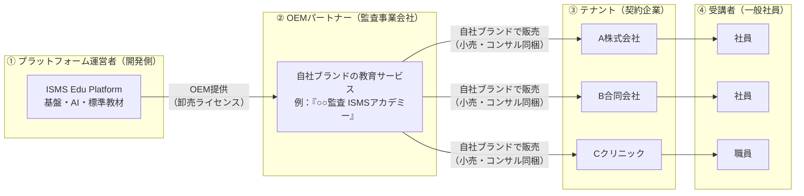
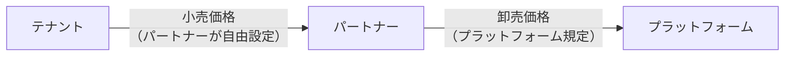
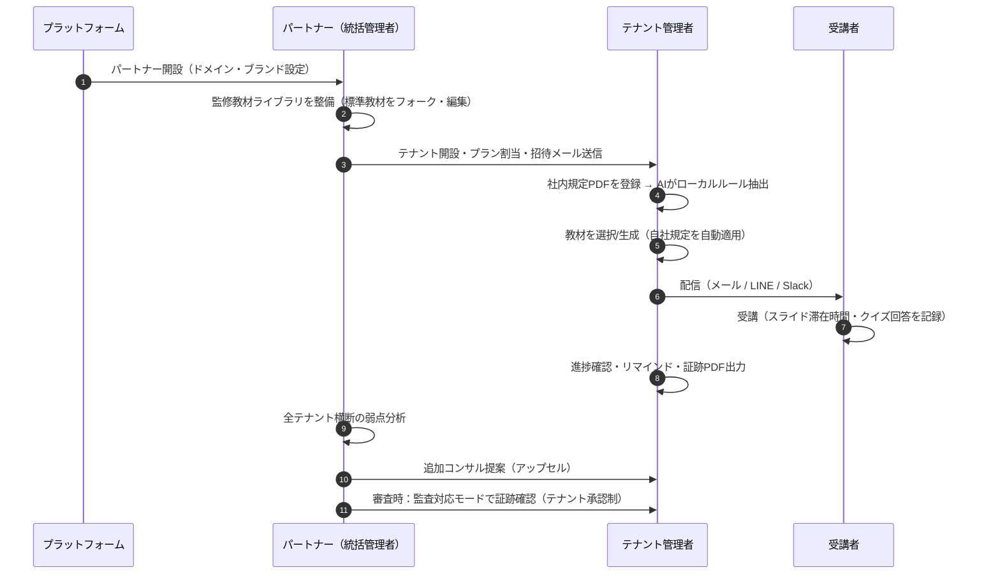
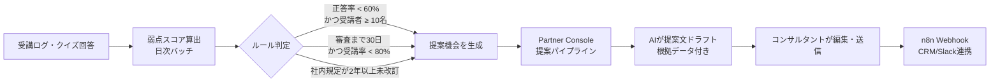
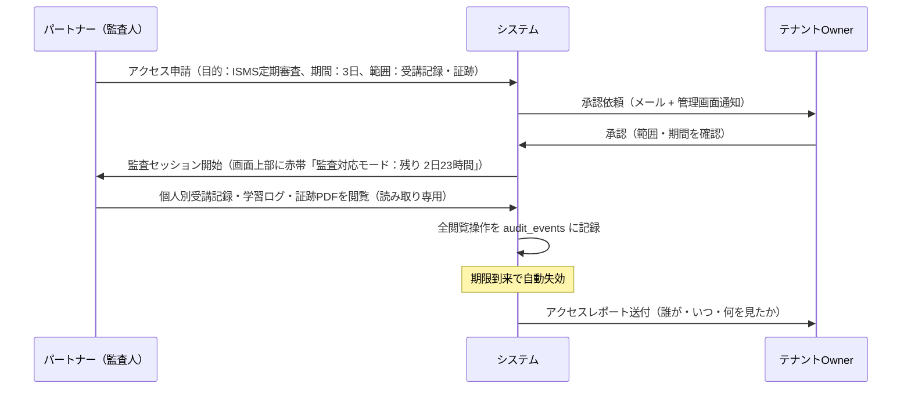
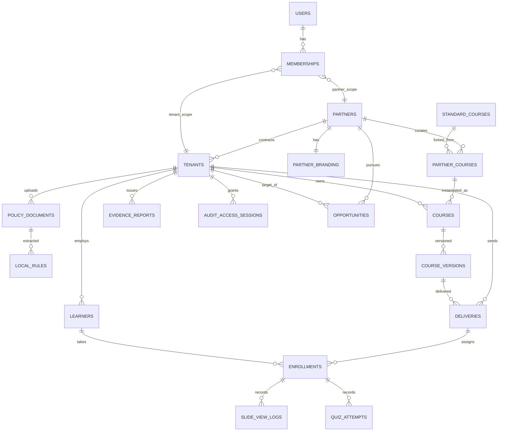
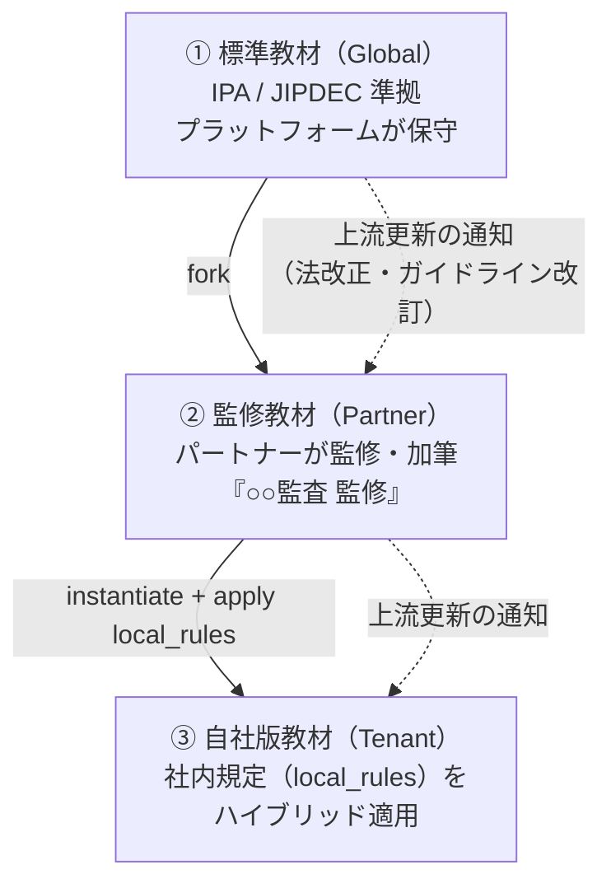
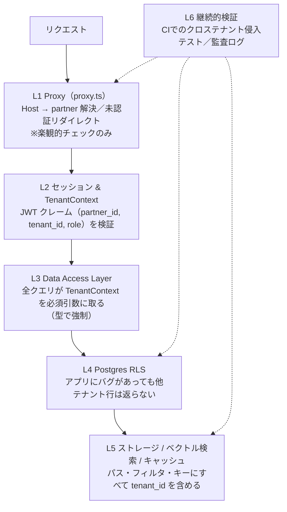
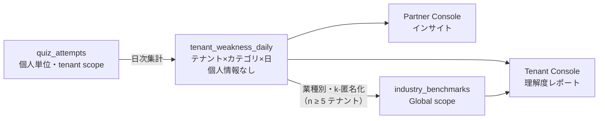
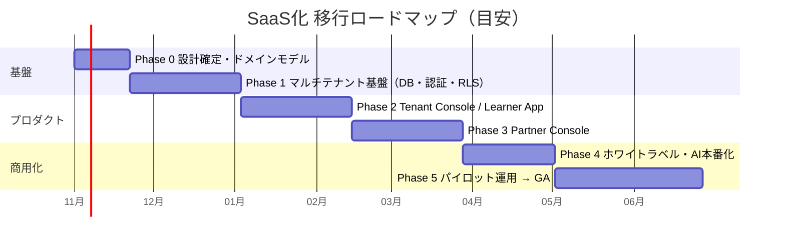

# ISMS教育資料管理ツール SaaS化 基本設計書

**— ホワイトラベル / OEM（B2B2B）モデルへの移行 —**

| 項目       | 内容                                                                      |
| ---------- | ------------------------------------------------------------------------- |
| 文書番号   | ISMS-EDU-ARCH-001                                                         |
| 版数       | 1.0（初版ドラフト）                                                       |
| 作成日     | 2026-10-17                                                                |
| 対象       | `isms-edu-proto`（Next.js 16 / React 19 / Supabase / Tailwind CSS v4）    |
| ステータス | レビュー待ち                                                              |
| 想定読者   | プロダクトオーナー、開発チーム、OEMパートナー（監査事業会社）の導入責任者 |

---

## 目次

0. [エグゼクティブサマリー](#0-エグゼクティブサマリー)
1. [システム概要とビジネスモデル](#1-システム概要とビジネスモデル)
2. [ユーザーロール（権限）の定義](#2-ユーザーロール権限の定義)
3. [画面構成と機能マッピング（UI/UX分離方針）](#3-画面構成と機能マッピングuiux分離方針)
4. [データアーキテクチャ（マルチテナント化）](#4-データアーキテクチャマルチテナント化)
5. [ホワイトラベル基盤](#5-ホワイトラベル基盤)
6. [セキュリティ・コンプライアンス設計](#6-セキュリティコンプライアンス設計)
7. [外部連携（n8n / Webhook）](#7-外部連携n8n--webhook)
8. [移行ロードマップ](#8-移行ロードマップ)
9. [リスクと未決事項](#9-リスクと未決事項)
10. [付録：用語集・現行コード対応表](#10-付録)

---

## 0. エグゼクティブサマリー

現行プロトタイプは「1人のコンサルタントが全社のデータを1つの管理画面で操作する」構造であり、教材生成・配信・弱点分析・アップセル提案・証跡出力が**同一画面上に同居**している。これはデモには最適だが、SaaSとして第三者（契約企業）に開放した瞬間に次の3つの問題が顕在化する。

1. **データ境界がない** — 企業の切り替えが `?corp=A` という URL パラメータと静的定数で行われており、URL を書き換えるだけで他社のデータが見える。
2. **見せてはいけないものが見える** — 契約企業の担当者に「アップセル提案メール」「他社の弱点」が見えてしまう。
3. **誰のブランドで提供しているかが曖昧** — OEM 元（監査事業会社）のブランドで売るための仕組みがない。

本設計は、これらを以下の **4つの設計原則** で解決する。

| #   | 原則                                                       | 一言でいうと                                                                                 |
| --- | ---------------------------------------------------------- | -------------------------------------------------------------------------------------------- |
| P1  | **階層型テナンシー（Platform → Partner → Tenant → User）** | データは必ず「どのパートナーの、どのテナントのものか」を持つ                                 |
| P2  | **多層防御によるデータ分離（Defense in Depth）**           | アプリのバグがあっても DB（RLS）が他社データを返さない                                       |
| P3  | **ロール別プロダクト（Role-shaped Products）**             | 同じシステムだが、ロールごとに「別のプロダクト」に見えるほど UI を分ける                     |
| P4  | **コンテンツ継承（Content Inheritance）**                  | 標準教材 → パートナー監修教材 → 自社規定適用版、という「継承と上書き」で教材資産を再利用する |

> **設計思想の要約：**
> テナント管理者には「自社の教育が回る、静かで迷わない道具」を、
> OEM統括管理者には「全顧客を俯瞰し、次の一手（提案）が見えるコックピット」を、
> プラットフォームには「誰にも気づかれず、すべてを安全に支える土台」を。

---

## 1. システム概要とビジネスモデル

### 1.1 ホワイトラベル / OEM（B2B2B）モデルの概念



- **プラットフォーム運営者**は、システムそのもの・AI 生成エンジン・IPA/JIPDEC 準拠の「標準教材ライブラリ」を提供する。**エンドユーザーからは見えない黒子**である。
- **OEM パートナー（監査事業会社）**は、プラットフォームを**自社ブランドのサービス**として契約企業へ提供する。独自ドメイン・ロゴ・配色・メール差出人をすべて自社のものにできる。
- **テナント（契約企業）**は、パートナーから「監査・コンサルティングと一体になった教育サービス」として購入する。プラットフォーム運営者の存在を意識しない。
- **受講者**は、自社専用ポータルで教材を受講する。

### 1.2 なぜこのモデルが強いのか（価値の連鎖）

| 主体             | 得られる価値                                                                                                                                            |
| ---------------- | ------------------------------------------------------------------------------------------------------------------------------------------------------- |
| プラットフォーム | 営業網を持つパートナー経由でスケール。1社の開拓で数十社のテナントを獲得できる（**チャネル・レバレッジ**）                                               |
| パートナー       | 「審査・コンサル」というスポット売上に、**教育サービスという継続課金（ストック）** を上乗せできる。弱点データが次の提案を生む（**アップセル・ループ**） |
| テナント         | ISMS / Pマーク審査で必要な「教育の実施記録（ISO/IEC 27001 箇条7.2・7.3、附属書A 6.3）」が自動で揃う。自社規定に沿った教材が手間なく作れる               |
| 受講者           | スマホで10分、自社のルールに即した「自分ごと」の教材で学べる                                                                                            |

### 1.3 マネタイズ設計

**二層の料金体系（Wholesale / Retail 分離）** を採用する。プラットフォームはテナントに直接請求しない。



#### 1.3.1 プラットフォーム → パートナー（卸売）

| 課金要素             | 単位                             | 備考                                                                                              |
| -------------------- | -------------------------------- | ------------------------------------------------------------------------------------------------- |
| パートナー基本料     | 月額固定                         | 独自ドメイン・ブランディング・OEM コンソール利用権                                                |
| アクティブ受講者課金 | 月間アクティブ受講者数 × 単価    | 「登録者」ではなく「当月1回以上ログインした人」で課金（MAU 方式）。パートナーの在庫リスクを減らす |
| AI 生成クレジット    | 教材生成1回 / 社内規定PDF解析1回 | 原価（LLM トークン費用）連動。プラン内包分 + 従量                                                 |
| オプション           | 機能単位                         | LINE/Slack 通知、SSO 連携、証跡PDFの電子署名 等                                                   |

#### 1.3.2 パートナー → テナント（小売）

パートナーが**完全に自由**に価格設定する。プラットフォームはパートナー向けに以下を提供する。

- **プラン（Entitlement）テンプレート**：パートナーが「ライト / スタンダード / プレミアム」等を定義し、テナントごとに機能フラグと上限値を割り当てる。
- **利用量レポート**：テナント別の MAU・AI 生成回数を月次 CSV / Webhook でエクスポート（パートナーの請求業務用）。
- **将来拡張**：Stripe Connect によるパートナー代行請求（Phase 5 以降の検討事項）。

### 1.4 運用フロー（ライフサイクル）



---

## 2. ユーザーロール（権限）の定義

### 2.1 ロール階層

4つの**主ロール**の下に、実運用で必要になる**サブロール**を定義する。最小権限の原則（Principle of Least Privilege）に基づき、サブロールは「できること」を最小に保つ。

| 階層     | 主ロール               | サブロール（`role` 値）                           | 想定ユーザー                                                 |
| -------- | ---------------------- | ------------------------------------------------- | ------------------------------------------------------------ |
| Platform | プラットフォーム管理者 | `platform_admin` / `platform_support`             | 開発・運営チーム                                             |
| Partner  | OEM統括管理者          | `partner_owner` / `partner_consultant`            | 監査事業会社の代表・管理者（例：青木様）／所属コンサルタント |
| Tenant   | テナント管理者         | `tenant_owner` / `tenant_admin` / `tenant_viewer` | 契約企業の情報セキュリティ責任者／教育担当／部門長           |
| Learner  | 一般受講者             | `learner`                                         | 契約企業の一般社員                                           |

> **補足：`partner_consultant` を設ける理由**
> パートナー企業が成長しコンサルタントが複数名になったとき、全員が全テナントを見られる状態は、パートナー自身の情報管理（ISMS 的にも）として望ましくない。コンサルタントには**担当テナントのみ**を割り当てる（`partner_tenant_assignments`）。

### 2.2 各ロールの責務と「見えないもの」

#### ① プラットフォーム管理者（`platform_admin` / `platform_support`）

| できること                                                                         | 見えない・できないこと                                                        |
| ---------------------------------------------------------------------------------- | ----------------------------------------------------------------------------- |
| パートナーの開設・停止・卸売プラン設定                                             | **テナントの業務データ（受講者氏名・回答・社内規定PDF本文）は既定で閲覧不可** |
| 標準教材ライブラリ（IPA/JIPDEC基準）の管理                                         | パートナーの小売価格・顧客との契約情報                                        |
| システム全体の稼働監視・利用量集計（件数レベル）                                   | —                                                                             |
| AIモデル・プロンプトのバージョン管理                                               | —                                                                             |
| **サポートアクセス（JIT）**：パートナー/テナントの承認付き・時間制限付きで一時閲覧 | 承認なしのなりすましログイン（Impersonation）は**存在しない機能とする**       |

> **設計判断：** 「運営者は全部見られる」設計は、パートナーが顧客に「御社のデータは当社以外誰も見ません」と言えなくなり、OEM 商材としての価値を毀損する。運営者のデータアクセスは**例外的・記録付き・期限付き**に限定する。

#### ② OEM統括管理者（`partner_owner` / `partner_consultant`）

| できること                                                   | 見えない・できないこと                                                                                      |
| ------------------------------------------------------------ | ----------------------------------------------------------------------------------------------------------- |
| テナントの開設・プラン割当・停止・テナント管理者の招待       | **他パートナーのテナント・教材・データ**（存在自体が見えない）                                              |
| ブランド設定（ロゴ・配色・独自ドメイン・メール差出人）       | プラットフォームの原価・他パートナーの卸売条件                                                              |
| **監修教材ライブラリ**の作成・編集・テナントへの公開         | **テナントの受講者個人単位のデータ（既定）** — 集計値のみ。個人単位は「監査対応モード」でテナント承認時のみ |
| 全テナント横断の弱点分析ダッシュボード（テナント単位の集計） | テナントの社内規定PDF原本（※テナントが「パートナーと共有」を許可した場合のみ閲覧可）                        |
| **追加コンサル提案（アップセル）** の作成・送信・商談管理    | —                                                                                                           |
| 監査対応モード（テナント承認制・期限付き・読み取り専用）     | 監査対応モード中であってもデータの**編集・削除**                                                            |
| 利用量レポート・請求用データのエクスポート                   | —                                                                                                           |

#### ③ テナント管理者（`tenant_owner` / `tenant_admin` / `tenant_viewer`）

| できること                                                       | 見えない・できないこと                                                 |
| ---------------------------------------------------------------- | ---------------------------------------------------------------------- |
| 自社の社内規定PDF登録・AIによるローカルルール抽出結果の確認/修正 | **他テナントのあらゆるデータ**（存在自体が見えない）                   |
| 教材の選択（パートナー公開教材）・AI生成・編集・承認             | **アップセル提案機能・商談情報・他社比較の生データ**                   |
| 受講者の招待・グループ（部署/新入社員/管理職）管理               | パートナー内部のメモ・担当コンサルタント間のやりとり                   |
| 配信・リマインド・進捗管理                                       | プラットフォーム運営者の存在（ブランド上は完全にパートナーのサービス） |
| 証跡PDF（受講証明・実施報告書）の出力                            | 卸売価格・パートナーのプラン原価                                       |
| 監査対応モードのアクセス申請の**承認/拒否**、アクセス履歴の閲覧  | —                                                                      |
| 業界ベンチマーク（匿名化された同業他社平均）の閲覧               | ベンチマークを構成する個別企業名・個別値                               |

サブロールの差分：

| 操作                                   | `tenant_owner` | `tenant_admin` | `tenant_viewer`  |
| -------------------------------------- | :------------: | :------------: | :--------------: |
| 進捗・証跡の閲覧                       |       ✅       |       ✅       | ✅（自部署のみ） |
| 教材の生成・編集・配信                 |       ✅       |       ✅       |        —         |
| 受講者の招待・削除                     |       ✅       |       ✅       |        —         |
| 社内規定PDFの登録・パートナー共有設定  |       ✅       |       ✅       |        —         |
| 監査対応モードの承認                   |       ✅       |       —        |        —         |
| テナント管理者の追加・権限変更         |       ✅       |       —        |        —         |
| データエクスポート・解約時のデータ取得 |       ✅       |       —        |        —         |

#### ④ 一般受講者（`learner`）

| できること                               | 見えない・できないこと                                                         |
| ---------------------------------------- | ------------------------------------------------------------------------------ |
| 自分に配信された教材の受講・クイズ回答   | 他の受講者の進捗・点数                                                         |
| 自分の受講履歴・修了証の確認             | 管理画面全般                                                                   |
| 教材への質問・フィードバック送信（任意） | 「自社規定を適用した」等のシステム内部の生成メタ情報（教材として自然に見える） |

### 2.3 権限マトリクス（機能 × ロール）

凡例：✅ 可能 ／ 👁 閲覧のみ ／ 📊 集計値のみ ／ 🔐 承認付き一時アクセス ／ — 不可

| 機能                       |  Platform  |   Partner Owner    | Partner Consultant | Tenant Owner/Admin | Tenant Viewer | Learner  |
| -------------------------- | :--------: | :----------------: | :----------------: | :----------------: | :-----------: | :------: |
| パートナー管理             |     ✅     |         —          |         —          |         —          |       —       |    —     |
| 標準教材ライブラリ         |     ✅     |         👁         |         👁         |         —          |       —       |    —     |
| ブランド設定               |     —      |         ✅         |         —          |         —          |       —       |    —     |
| テナント開設・プラン割当   |     —      |         ✅         |         —          |         —          |       —       |    —     |
| 監修教材ライブラリ         |     —      |         ✅         |   ✅（担当範囲）   |         👁         |       —       |    —     |
| 社内規定PDF                |     —      |    🔐（共有時）    |    🔐（共有時）    |         ✅         |       —       |    —     |
| 教材生成・編集             |     —      |         ✅         |   ✅（担当のみ）   |         ✅         |       —       |    —     |
| 配信・リマインド           |     —      |         —          |         —          |         ✅         |       —       |    —     |
| 進捗（個人単位）           |     —      |         🔐         |         🔐         |         ✅         | 👁（自部署）  | 自分のみ |
| 進捗・弱点（テナント集計） |     📊     |         ✅         |   ✅（担当のみ）   |         ✅         |      👁       |    —     |
| 全テナント横断分析         |     —      |         ✅         |   ✅（担当のみ）   |         —          |       —       |    —     |
| アップセル提案             |     —      |         ✅         |   ✅（担当のみ）   |         —          |       —       |    —     |
| 証跡PDF出力                |     —      |  🔐（監査モード）  |  🔐（監査モード）  |         ✅         |      👁       |    —     |
| 監査対応モード承認         |     —      |         —          |         —          |    ✅（Owner）     |       —       |    —     |
| 受講                       |     —      |         —          |         —          |     ✅（任意）     |  ✅（任意）   |    ✅    |
| 監査ログ閲覧               | ✅（全体） | ✅（自パートナー） |         —          |  ✅（自テナント）  |       —       |    —     |

### 2.4 ユーザーとメンバーシップのモデル

1人の人物が複数の立場を持つケース（例：テナント管理者自身も受講者である、コンサルタントが複数テナントを担当する）に対応するため、**「ユーザー（人）」と「メンバーシップ（所属と役割）」を分離**する。

```
users (1) ──< memberships >── (1) organizations
                │
                └── role, scope_type (platform|partner|tenant), status
```

- ログイン後、複数のメンバーシップを持つユーザーには**ワークスペース切替**（Slack/Notion 型）を提示する。
- 有効なワークスペースは**セッションに保持**し、URL パラメータでは切り替えない（現行 `?corp=` 方式の廃止）。

---

## 3. 画面構成と機能マッピング（UI/UX分離方針）

### 3.1 基本方針：「1つのコードベース、4つのプロダクト」

| アプリ（体験）      | URL（例：パートナー独自ドメイン `learn.aoki-audit.jp` 上）    | 設計キーワード                                       |
| ------------------- | ------------------------------------------------------------- | ---------------------------------------------------- |
| **Learner App**     | `/learn`                                                      | モバイルファースト・10分完結・迷わない               |
| **Tenant Console**  | `/admin`                                                      | シンプル・タスク指向・「今月やること」が一目でわかる |
| **Partner Console** | `/console`                                                    | 俯瞰・比較・アクション（提案）につながるコックピット |
| **Platform Ops**    | `ops.<platform-domain>`（パートナードメインとは**別ホスト**） | 運用・監視・最小限のデータ露出                       |

- **Platform Ops は別ホストに分離**する。パートナーのドメイン上に運営者の管理画面が存在しないことで、ホワイトラベルの一貫性とアタックサーフェスの縮小を両立する。
- Next.js App Router の **Route Groups** でコード上も明確に分離する（§3.6）。

### 3.2 現行機能の再配置マップ

現行の `/admin/*` に同居している機能を、ロール別に分解・再配置する。

| 現行画面                           | 現行の機能                                                   | 新配置                                                                                                                                            |
| ---------------------------------- | ------------------------------------------------------------ | ------------------------------------------------------------------------------------------------------------------------------------------------- |
| `/admin/dashboard`                 | 受講進捗・企業選択・弱点分析・アップセルメール・証跡出力導線 | **分割**：進捗 → Tenant「ホーム」／弱点分析（自社のみ・提案なし）→ Tenant「理解度レポート」／全社比較・アップセル → Partner「インサイト」「提案」 |
| `/admin/generate`                  | トピック選択・社内規定適用・AI生成・編集・公開               | **両方に配置**：Tenant「教材をつくる」（自社規定が自動適用、選択不要）／Partner「監修教材スタジオ」（テンプレート作成）                           |
| `/admin/courses`                   | ストック教材・再配信                                         | **分割**：Partner「監修教材ライブラリ」（公開先テナントの管理）／Tenant「教材ライブラリ」（自社で使える教材のみ）                                 |
| `/admin/materials`（参考資料タブ） | AI学習用の参考資料（PPTX/PDF）                               | **Partner へ移動**：パートナーのナレッジベース（監査ノウハウ・JIPDEC資料）。テナントには見せない                                                  |
| `/admin/materials`（社内規定タブ） | 企業ごとの社内規定PDF・AI解析                                | **Tenant へ移動**：Tenant「社内規定」。自社の規定のみ。企業選択プルダウンは不要になる                                                             |
| `/admin/distribution`              | 全社の配信状況・リマインド                                   | **Tenant へ移動**：自社の配信のみ。Partner には「テナント別 配信実施状況（集計）」として提供                                                      |
| `/admin/evidence?corp=`            | 証跡PDF                                                      | **Tenant**：自社の証跡出力／**Partner**：監査対応モード内で閲覧。`corp` パラメータは廃止                                                          |
| `/pages/course?corp=`              | 受講ポータル                                                 | **Learner App** `/learn`。テナントはセッションから決定                                                                                            |

### 3.3 テナント管理者向けUI（Tenant Console）

**設計コンセプト：「教育担当者が月に1回開いて、10分で仕事が終わる」**

テナント管理者は情報セキュリティの専門家とは限らない（総務兼任が多い）。機能を並べるのではなく、**年間の教育サイクル（計画 → 実施 → 確認 → 記録）に沿ったナビゲーション**にする。

```
┌─────────────────────────────────────────────────────────────────┐
│ [パートナーロゴ]  A株式会社 教育ポータル管理           [?] [山田▼] │
├──────────────┬──────────────────────────────────────────────────┤
│ 🏠 ホーム      │  今月やること                                     │
│ 📚 教材        │  ┌───────────────────────────────────────────┐  │
│   ├ ライブラリ  │  │ ⚠ 未受講者 12名 — 締切まであと5日 [リマインド] │  │
│   └ 教材をつくる │  │ ✅ 年次教育「標的型メール」受講率 87%          │  │
│ 📤 配信と進捗   │  │ 📄 審査まであと30日 — 証跡PDFを準備 [出力]     │  │
│ 📊 理解度レポート│  └───────────────────────────────────────────┘  │
│ 📄 証跡・記録   │  年間教育計画（タイムライン）                       │
│ 📘 社内規定     │  4月 新入社員教育 ✅ ─ 7月 標的型メール ✅ ─ 10月 …│
│ 👥 受講者管理   │                                                  │
│ ⚙ 設定         │                                                  │
└──────────────┴──────────────────────────────────────────────────┘
```

| メニュー                | 主な機能                                                                                                                                                                         |
| ----------------------- | -------------------------------------------------------------------------------------------------------------------------------------------------------------------------------- |
| **ホーム**              | 「今月やること」カード（未受講リマインド・審査日カウントダウン・新着推奨教材）、年間教育計画タイムライン、全体受講率                                                             |
| **教材 › ライブラリ**   | パートナーが公開した監修教材＋自社で作成した教材。各教材に「自社規定適用済み」バッジ。ワンクリックで配信                                                                         |
| **教材 › 教材をつくる** | キーワード入力 → AI生成。**登録済みの社内規定は自動で適用**（プロトタイプの規定選択UIは不要）。生成後はスライド/クイズを編集 → 承認 → ライブラリへ                               |
| **配信と進捗**          | 配信ウィザード（教材 → 対象グループ → 期限 → 通知チャネル）、配信ごとの進捗、未受講者への一括リマインド                                                                          |
| **理解度レポート**      | 自社のカテゴリ別正答率・弱点（現行の弱点分析を**自社分のみ・提案導線なし**で提供）、匿名化された業界平均との比較。弱点に対しては「おすすめ教材を配信」という**自己解決型の導線** |
| **証跡・記録**          | 証跡PDF（受講証明書・実施報告書・学習ログ）出力、出力履歴、監査対応モードの承認とアクセス履歴                                                                                    |
| **社内規定**            | PDFアップロード → AI解析進捗 → 抽出ルール一覧（確認・修正・無効化）、「担当コンサルタントと共有する」トグル                                                                      |
| **受講者管理**          | CSV一括登録、招待、グループ管理、SSO設定（プランによる）                                                                                                                         |

**テナントUIで「意図的に見せないもの」**

- アップセル・提案・商談に関わる文言やボタン（**一切表示しない**）
- 他社名・他社の数値
- AIの内部状態（RAG、ベクトル検索、トークン数など）
- 代わりに、パートナーが任意で設定できる**中立的な相談導線**のみ配置可能：「担当コンサルタントに相談する」（パートナーの問い合わせ窓口へ）

### 3.4 OEM統括管理者向けUI（Partner Console）

**設計コンセプト：「全顧客の健康状態が一目でわかり、次に打つべき手が提示されるコックピット」**

```
┌──────────────────────────────────────────────────────────────────────┐
│ [自社ロゴ] ○○監査 ISMSアカデミー  統括コンソール            [青木▼]   │
├───────────────┬──────────────────────────────────────────────────────┤
│ 📈 ポートフォリオ │ 顧客ヘルススコア                                       │
│ 🏢 テナント      │ ┌──────────┬──────┬──────┬────────┬─────────────┐ │
│ 🔍 インサイト    │ │ 企業       │受講率 │正答率 │審査まで │ シグナル       │ │
│ 💼 提案パイプライン│ │ A株式会社  │ 92%  │ 85%  │ 45日   │ 🟢 良好        │ │
│ 📚 監修教材スタジオ│ │ B合同会社  │ 61%  │ 58%  │ 12日   │ 🔴 要フォロー  │ │
│ 🧠 ナレッジベース │ │ Cクリニック │ 78%  │ 49%  │ 90日   │ 🟡 提案機会 2件 │ │
│ 🛡 監査対応      │ └──────────┴──────┴──────┴────────┴─────────────┘ │
│ 🎨 ブランド設定   │                                                      │
│ 📑 利用量・請求   │                                                      │
└───────────────┴──────────────────────────────────────────────────────┘
```

| メニュー             | 主な機能                                                                                                                                                                                                                 |
| -------------------- | ------------------------------------------------------------------------------------------------------------------------------------------------------------------------------------------------------------------------ |
| **ポートフォリオ**   | 全テナントの**ヘルススコア**（受講率・正答率・審査までの日数・ログイン頻度から算出）。「要フォロー」「提案機会あり」でソート                                                                                             |
| **テナント**         | テナント一覧・開設ウィザード（企業情報 → プラン → 管理者招待 → 初期教材セット）・プラン変更・停止・担当コンサルタント割当                                                                                                |
| **インサイト**       | 全テナント横断の**弱点分析ダッシュボード**：カテゴリ × テナントのヒートマップ、業種別比較、時系列推移。個人名は出さずテナント単位の集計                                                                                  |
| **提案パイプライン** | 弱点シグナルから自動生成される**「提案機会（Opportunity）」の受信箱** → AIが提案メール文面をドラフト → 編集・送信 → ステータス管理（未着手 / 提案済 / 商談中 / 受注 / 失注）。現行のワンクリックアップセルメールの発展形 |
| **監修教材スタジオ** | 標準教材のフォーク、監修教材の作成・版管理、テナントへの公開設定（全テナント / 業種別 / 個別）                                                                                                                           |
| **ナレッジベース**   | パートナー独自の参考資料（監査ノウハウ・過去指摘事項・JIPDEC資料）登録。AI生成時にこのパートナーの全テナントで参照される                                                                                                 |
| **監査対応**         | 監査対応モードのアクセス申請・セッション管理（§3.5）                                                                                                                                                                     |
| **ブランド設定**     | ロゴ・配色・独自ドメイン・メール差出人・証跡PDFの発行者名/角印画像・フッター表記                                                                                                                                         |
| **利用量・請求**     | テナント別 MAU・AI生成回数・月次エクスポート（CSV / Webhook）                                                                                                                                                            |

#### 3.4.1 アップセルを「押し売り」にしない仕組み：シグナル駆動型提案



- 提案は常に**根拠データ（どのカテゴリで何%）とセット**で生成し、「データに基づくコンサルティング」として顧客に届ける。
- ルールはパートナーごとにカスタマイズ可能（閾値・提案メニュー・価格帯）。

### 3.5 監査対応モード（Audit Access Session）

審査・内部監査の場面で、パートナー（監査人）がテナントの**個人単位の受講記録**を確認する必要がある。これを「常時閲覧権限」ではなく**「承認付き・期限付き・読み取り専用のセッション」**として実装する。これは本システムの信頼性を象徴する機能であり、**営業上の差別化ポイント**にもなる。



| 項目   | 仕様                                                                          |
| ------ | ----------------------------------------------------------------------------- |
| 申請者 | `partner_owner` / 担当の `partner_consultant`                                 |
| 承認者 | `tenant_owner`（事前包括承認：「審査期間中は自動承認」設定も可）              |
| 範囲   | `progress`（受講記録）／`evidence`（証跡）／`policies`（社内規定）を選択      |
| 期限   | 最長14日。延長は再申請                                                        |
| 権限   | 読み取り専用。エクスポートは証跡PDFのみ（透かし「監査対応モードで出力」入り） |
| 記録   | 開始/終了/閲覧画面/出力をすべて記録し、テナントがいつでも閲覧可能             |

### 3.6 Learner App（受講者UI）

- **完全モバイルファースト**。通知（メール / LINE / Slack）のリンクからワンタップでログイン → 受講開始（マジックリンク / SSO）。
- メールアドレスを持たない職員（医療・製造現場など）向けに **「社員番号 + テナント別パスコード」** ログインを用意（プランで有効化）。
- 画面は「受講すべき教材」「完了した教材」「修了証」の3つのみ。
- ブランドは**パートナー × テナント**の二段（ヘッダー：テナント名、フッター：パートナー提供表記）。

### 3.7 ルーティング・コード構成（Next.js 16 App Router）

```
app/
├── (learn)/learn/...                 # Learner App
│   ├── page.tsx                      # 受講すべき教材
│   └── courses/[courseId]/page.tsx   # 受講画面（スライド＋クイズ）
├── (tenant)/admin/...                # Tenant Console
│   ├── layout.tsx                    # requireRole(["tenant_*"]) をサーバー側で検証
│   ├── page.tsx                      # ホーム
│   ├── library/  generate/  deliveries/  reports/
│   ├── evidence/  policies/  members/  settings/
├── (partner)/console/...             # Partner Console
│   ├── layout.tsx                    # requireRole(["partner_*"])
│   ├── page.tsx                      # ポートフォリオ
│   ├── tenants/  insights/  opportunities/  studio/
│   ├── knowledge/  audit/  branding/  usage/
├── (auth)/login/  invite/[token]/  select-workspace/
└── api/
    ├── webhooks/...                  # 受信（LINE/Slack/決済）
    └── v1/...                        # 外部公開API（将来）
ops/                                  # Platform Ops は別 Next.js アプリ（モノレポ化）推奨
proxy.ts                              # Host → partner 解決、未認証リダイレクト（楽観的チェックのみ）
lib/
├── auth/session.ts                   # getSession(), requireRole()
├── tenancy/context.ts                # TenantContext の解決（Host + セッション）
├── dal/                              # Data Access Layer（全DBアクセスはここ経由）
└── branding/                         # テーマトークン解決
```

> **重要（Next.js 16）：** `middleware.ts` は `proxy.ts` に改称されている。公式ドキュメント（`node_modules/next/dist/docs/01-app/01-getting-started/16-proxy.md`）が明記している通り、**Proxy は楽観的チェック（リダイレクト等）専用であり、認可の最終判断に使ってはならない**。認可は必ず Server Component / Server Action / Route Handler 内の DAL と、DB の RLS で行う。

---

## 4. データアーキテクチャ（マルチテナント化）

### 4.1 テナンシーモデルの選定

| 方式                                  |    分離強度     | 運用コスト | スケール |  採否  |
| ------------------------------------- | :-------------: | :--------: | :------: | :----: |
| DB分離（テナントごとにDB）            |      最高       |    高い    |   低い   |   ✗    |
| スキーマ分離（テナントごとに schema） |       高        |   中〜高   |    中    |   ✗    |
| **共有スキーマ + `tenant_id` + RLS**  | 高（RLS併用時） |    低い    |   高い   | **✅** |

**採用：共有スキーマ + 行レベルセキュリティ（Postgres RLS）**。Supabase の標準機能で実現でき、数百パートナー・数万テナント規模まで1つのDBで運用可能。将来、大口テナントの専用環境要望には「専用プロジェクト（Silo）」をオプションとして提供する（ハイブリッド・モデル）。

### 4.2 二段の識別子：`partner_id` と `tenant_id`

ご要望の `tenant_id` に加え、**`partner_id` も全テナントデータに持たせる（非正規化）**。

- 理由1：Partner Console の横断クエリ（「自パートナーの全テナント」）を JOIN なしで RLS 判定できる。
- 理由2：パートナー間の分離（A監査法人とB監査法人のデータが混ざらない）を、テナント間の分離と同じ強度で保証できる。
- 整合性：`tenant_id → partner_id` の対応は複合外部キーで強制し、不整合を DB レベルで不可能にする（§4.4）。

### 4.3 データのスコープ分類

全テーブルを次の4スコープのいずれかに分類する。**「どのスコープか分からないテーブル」は作らない**ことをレビュー基準とする。

| スコープ | 持つ列                                     | 例                                                                                                                                            |
| -------- | ------------------------------------------ | --------------------------------------------------------------------------------------------------------------------------------------------- |
| Global   | なし                                       | `standard_courses`（標準教材）、`ipa_knowledge_chunks`、`plans_catalog`                                                                       |
| Partner  | `partner_id`                               | `partner_branding`、`partner_courses`（監修教材）、`partner_knowledge_chunks`、`opportunities`                                                |
| Tenant   | `partner_id`, `tenant_id`                  | `courses`、`policy_documents`、`local_rules`、`learners`、`deliveries`、`enrollments`、`slide_view_logs`、`quiz_attempts`、`evidence_reports` |
| User     | `user_id`（+ tenant スコープの場合は両方） | `user_profiles`、`notification_preferences`                                                                                                   |

### 4.4 ER図（主要エンティティ）



### 4.5 コンテンツ継承モデル（教材の3階層）

現行の「IPA標準基準」「D社規定適用済み」というバッジの概念を、データモデルとして正式化する。



- 各教材は `source_type`（`standard` / `partner` / `tenant`）と `source_id`、`source_version` を持ち、**系譜（Lineage）** を追跡できる。
- 上流（例：IPAガイドライン改訂で標準教材が更新）が変わったら、下流に「更新があります」と通知し、**差分を確認してから取り込む**（自動上書きはしない：審査で使った版が勝手に変わると証跡の整合性が崩れるため）。
- 配信は常に**特定の版（`course_versions`）** に紐づく。受講記録・証跡は「どの版で学んだか」を永続的に指し示す（現行の「改訂履歴テーブル」の正式化）。

### 4.6 DDL サンプル（抜粋・`deliveries` / `learners` 等の定義は省略）

```sql
-- ============================================================
-- 組織階層
-- ============================================================
create table partners (
  id            uuid primary key default gen_random_uuid(),
  slug          text not null unique,               -- 例: aoki-audit
  display_name  text not null,
  status        text not null default 'active'
                check (status in ('active','suspended','terminated')),
  created_at    timestamptz not null default now()
);

create table tenants (
  id            uuid primary key default gen_random_uuid(),
  partner_id    uuid not null references partners(id),
  slug          text not null,
  display_name  text not null,                      -- 例: A株式会社
  industry      text,                               -- ベンチマーク用（例: medical）
  plan_code     text not null,
  audit_due_on  date,                               -- 次回審査予定日
  status        text not null default 'active'
                check (status in ('trial','active','suspended','offboarding','deleted')),
  created_at    timestamptz not null default now(),
  unique (partner_id, slug),
  unique (partner_id, id)                           -- 複合FKの参照先
);

-- ============================================================
-- テナントスコープのテーブルは必ず (partner_id, tenant_id) を持つ
-- 複合FKで「tenant は必ずその partner に属する」ことを DB が保証
-- ============================================================
create table courses (
  id              uuid primary key default gen_random_uuid(),
  partner_id      uuid not null,
  tenant_id       uuid not null,
  title           text not null,
  source_type     text not null check (source_type in ('standard','partner','tenant')),
  source_id       uuid,
  current_version int  not null default 1,
  created_at      timestamptz not null default now(),
  foreign key (partner_id, tenant_id) references tenants(partner_id, id),
  unique (tenant_id, id)
);

create table enrollments (
  id            uuid primary key default gen_random_uuid(),
  partner_id    uuid not null,
  tenant_id     uuid not null,
  delivery_id   uuid not null,
  learner_id    uuid not null,
  status        text not null check (status in ('not_started','in_progress','completed')),
  score_rate    smallint check (score_rate between 0 and 100),
  completed_at  timestamptz,
  foreign key (partner_id, tenant_id) references tenants(partner_id, id),
  -- 参照先も同じ tenant_id であることを強制（他テナントの配信・受講者を参照できない）
  foreign key (tenant_id, delivery_id) references deliveries(tenant_id, id),
  foreign key (tenant_id, learner_id)  references learners(tenant_id, id)
);

create index on enrollments (tenant_id, status);
```

> **ポイント：複合外部キーによる「参照の分離」**
> RLS は「読めるか」を守るが、「A社の受講記録が誤ってB社の配信を参照する」という**書き込み時の混線**は防げない。`(tenant_id, id)` を参照先とする複合FKにより、異なるテナント間の参照を DB が物理的に拒否する。

### 4.7 分離の仕組み：多層防御（Defense in Depth）



#### L2：JWT カスタムクレーム

Supabase Auth の **Custom Access Token Hook** で、ログイン時に選択中ワークスペースのクレームを JWT に埋め込む。

```json
{
  "sub": "8b1c...",
  "app_role": "tenant_admin",
  "partner_id": "0f3a...",
  "tenant_id": "5d2e...",
  "membership_id": "a91c..."
}
```

- ワークスペース切替時はトークンを再発行する。
- クレームはサーバー側で発行されるため、クライアントが改ざんできない（`?corp=` 方式との本質的な違い）。

#### L3：Data Access Layer（型で強制する）

```ts
// lib/tenancy/context.ts
export type TenantContext = {
  readonly partnerId: string;
  readonly tenantId: string;
  readonly role: TenantRole;
  readonly userId: string;
};

// lib/dal/enrollments.ts
import "server-only";

export async function listEnrollments(ctx: TenantContext, deliveryId: string) {
  // ctx を受け取らない関数は DAL に存在させない（ESLint ルールで直接の supabase 呼び出しを禁止）
  return db
    .from("enrollments")
    .select("id, status, score_rate, completed_at, learner:learners(name)")
    .eq("tenant_id", ctx.tenantId) // RLS と二重化（明示的フィルタはインデックス利用にも有効）
    .eq("delivery_id", deliveryId);
}
```

- `lib/supabase.ts` のクライアントを画面から直接 import することを ESLint（`no-restricted-imports`）で禁止し、DAL 経由を強制する。
- **`service_role` キーはリクエスト処理経路で使用禁止**（バッチ・マイグレーション専用の別モジュールに隔離）。service_role は RLS をバイパスするため。

#### L4：RLS ポリシー

```sql
alter table enrollments enable row level security;
alter table enrollments force row level security;

-- ヘルパー：JWT クレームの取得
create function auth_tenant_id()  returns uuid language sql stable as
  $$ select nullif(auth.jwt() ->> 'tenant_id', '')::uuid $$;
create function auth_partner_id() returns uuid language sql stable as
  $$ select nullif(auth.jwt() ->> 'partner_id', '')::uuid $$;
create function auth_role()       returns text language sql stable as
  $$ select auth.jwt() ->> 'app_role' $$;

-- テナント管理者：自テナントのみ
create policy tenant_staff_read on enrollments for select
  using (
    auth_role() in ('tenant_owner','tenant_admin','tenant_viewer')
    and tenant_id = auth_tenant_id()
  );

-- 受講者：自分の受講記録のみ
create policy learner_read_own on enrollments for select
  using (
    auth_role() = 'learner'
    and tenant_id = auth_tenant_id()
    and learner_id = (select id from learners where user_id = auth.uid() and tenant_id = auth_tenant_id())
  );

-- パートナー：個人単位の行は「有効な監査セッションがある場合のみ」
create policy partner_audit_read on enrollments for select
  using (
    auth_role() in ('partner_owner','partner_consultant')
    and partner_id = auth_partner_id()
    and exists (
      select 1 from audit_access_sessions s
      where s.tenant_id = enrollments.tenant_id
        and s.grantee_user_id = auth.uid()
        and 'progress' = any(s.scopes)
        and s.status = 'approved'
        and now() between s.starts_at and s.expires_at
    )
  );
```

パートナーが**集計値**を見る経路は、個人情報を含まない**集計ビュー / マテリアライズドビュー**（`tenant_weakness_daily` など）に対する別ポリシーで提供する。これにより「集計は常時、個人単位は承認時のみ」という §2 の権限設計が DB レベルで保証される。

#### L5：ストレージ・AI・キャッシュの分離

| 対象                              | 分離方法                                                                                                                                                                                            |
| --------------------------------- | --------------------------------------------------------------------------------------------------------------------------------------------------------------------------------------------------- |
| Supabase Storage（社内規定PDF等） | パス規約 `{partner_id}/{tenant_id}/policies/{document_id}.pdf` ＋ Storage RLS（パス先頭とクレームの一致を検証）。署名付きURLは短寿命（5分）                                                         |
| ベクトル検索（RAG）               | チャンクに `scope`（global/partner/tenant）と `partner_id`/`tenant_id` を保持。検索RPCは `TenantContext` から**サーバー側で**フィルタを組み立て、「標準 ∪ 自パートナー ∪ 自テナント」以外を返さない |
| LLM プロンプト                    | 1回の生成リクエストに含めるコンテキストは単一テナント分のみ。生成ログは `tenant_id` 付きで保存。LLM プロバイダーとは**学習利用なし（ゼロデータリテンション）** の契約を前提とする                   |
| アプリキャッシュ                  | キャッシュキー・タグに必ず `tenant_id` を含める（例：`cacheTag("tenant:5d2e:enrollments")`）。テナント横断データをキャッシュするのは Global スコープのみ                                            |
| 通知（LINE/Slack）                | 連携トークンはテナント単位で暗号化保存（Supabase Vault）。送信ジョブは `tenant_id` 単位でキューイング                                                                                               |

#### L6：継続的検証

- **クロステナント侵入テスト**を CI に組み込む：テナントAのトークンで、テナントBの全テーブル・全APIにアクセスし、0件/403 であることを自動検証する。新テーブル追加時は「RLS 未設定テーブル検出スクリプト」がビルドを失敗させる。
- `audit_events`（追記専用）に、認証・権限変更・エクスポート・監査セッション・サポートアクセスを記録する。

### 4.8 分析データ（弱点分析・ベンチマーク）



- **k-匿名性**：業界ベンチマークは5テナント以上集まった業種・カテゴリのみ公開し、個社が特定されないようにする。
- ベンチマークは**パートナーを跨いで集計しない**のを既定とする（パートナーの顧客データを他パートナーの顧客価値に転用しない）。プラットフォーム全体ベンチマークはパートナー契約で同意が得られた場合のみ。

### 4.9 証跡（エビデンス）の完全性

審査で提出する証跡PDFは、**後から改ざんされていないこと**を証明できなければ価値が半減する。

| 仕組み               | 内容                                                                                                           |
| -------------------- | -------------------------------------------------------------------------------------------------------------- |
| スナップショット発行 | 出力時点のデータを `evidence_reports` に JSON スナップショットとして凍結保存（後でデータが変わっても再現可能） |
| ハッシュ             | スナップショットとPDFの SHA-256 を記録。PDF内に文書番号とハッシュ値を印字                                      |
| 検証URL / QRコード   | PDFのQRコードから「この証跡は真正です（発行日時・発行者）」を確認できる公開検証ページ（パートナードメイン上）  |
| 発行者表記           | パートナーのブランド名・角印画像（パートナー設定）で発行。プラットフォーム名は出さない                         |
| 保存期間             | ISMS 記録の保持方針に合わせ、既定5年（テナント設定で延長可）                                                   |

### 4.10 データライフサイクル

| イベント           | 処理                                                                                                                                                                                     |
| ------------------ | ---------------------------------------------------------------------------------------------------------------------------------------------------------------------------------------- |
| テナント解約       | `offboarding` へ遷移 → テナントOwnerが全データ（受講記録CSV・証跡PDF一式）をエクスポート可能な猶予期間90日 → 論理削除 → 30日後に物理削除（証跡は保存期間ポリシーに従い別途保持の選択可） |
| 受講者退職         | 受講者アカウントを無効化。受講記録は証跡として保持（氏名は保持期間経過後に仮名化）                                                                                                       |
| パートナー契約終了 | 配下テナントの移管オプション（プラットフォーム直契約 or 他パートナーへ移管、テナント同意必須）を提供。テナントの教育記録を人質にしない                                                   |
| 本人からの開示請求 | テナント管理者経由で対応（パートナー/プラットフォームは委託先の立場）                                                                                                                    |

### 4.11 現行型定義からの移行例

現行 `lib/types.ts` の `Tenant` は「ブランド設定」と「配信教材」が混在している。これを分解する。

| 現行フィールド（`Tenant`）    | 移行先                                                                           |
| ----------------------------- | -------------------------------------------------------------------------------- |
| `corp`                        | `tenants.slug`（ただし**認可には使わない**。表示・URL用のみ）                    |
| `name`                        | `tenants.display_name`                                                           |
| `portal_label` / `logo_label` | `tenant_settings`（テナント側の表示名カスタマイズ）                              |
| `accent`                      | `partner_branding`（色は原則パートナーが決め、テナントはロゴのみ差し替え可）     |
| `course_ids`                  | `deliveries` / `enrollments`（「配信」という事実から導出。静的な配列は持たない） |

`DistributionRecord.corp_name` や `ProgressRecord.company_name` のような**表示用の会社名の非正規化**は廃止し、`tenant_id` で参照する。

---

## 5. ホワイトラベル基盤

### 5.1 ドメイン戦略

| 方式                               | 例                                 | 対象                              |
| ---------------------------------- | ---------------------------------- | --------------------------------- |
| プラットフォーム提供サブドメイン   | `aoki-audit.isms-edu.app`          | 初期導入・トライアル              |
| **パートナー独自ドメイン（推奨）** | `academy.aoki-audit.jp`            | 本番運用。証明書は自動発行        |
| テナント識別                       | ドメインでなく**セッション**で識別 | テナントごとのDNS設定を不要にする |

- `proxy.ts` が `Host` ヘッダーから `partner_domains` テーブル（エッジ配信可能な設定ストアにキャッシュ）を引き、パートナーを解決する。
- ログイン時、ユーザーのメンバーシップが**そのパートナー配下**であることを検証する（他パートナーのドメインからはログインできない）。

### 5.2 ブランディングトークン

Tailwind CSS v4 の CSS 変数ベースのテーマ（現行 `app/globals.css`）を活かし、パートナーごとのトークンをサーバーで注入する。

```json
{
  "partner_id": "0f3a...",
  "brand_name": "○○監査 ISMSアカデミー",
  "logo_url": "https://.../logo.svg",
  "favicon_url": "https://.../favicon.ico",
  "color_primary": "oklch(0.55 0.15 250)",
  "color_primary_foreground": "oklch(0.98 0 0)",
  "font_family": "Noto Sans JP",
  "email_from_name": "○○監査 教育事務局",
  "email_from_address": "academy@aoki-audit.jp",
  "evidence_issuer_name": "○○監査株式会社",
  "evidence_seal_url": "https://.../seal.png",
  "support_url": "https://aoki-audit.jp/contact",
  "show_powered_by": false
}
```

- **アクセシビリティ・ガードレール**：パートナーが設定した配色はコントラスト比（WCAG AA 4.5:1）を自動検証し、不足する場合は前景色を自動補正する。
- **メール送信**：パートナー独自ドメインからの送信には SPF / DKIM / DMARC の設定ウィザードを提供。未設定の間はプラットフォームのドメインから「○○監査 教育事務局」名義で送信する。

---

## 6. セキュリティ・コンプライアンス設計

本サービスは「ISMS教育」を売るサービスである。**サービス自体がISMSのお手本でなければならない。**

| 領域           | 方針                                                                                                                                    |
| -------------- | --------------------------------------------------------------------------------------------------------------------------------------- |
| データ所在地   | 国内リージョン（Supabase 東京リージョン）。LLM 推論も国内リージョン提供のモデルを優先選択                                               |
| 認証           | 管理者ロールは MFA 必須。テナント管理者向けに SAML/OIDC SSO（Microsoft Entra ID / Google Workspace）をプラン提供                        |
| 暗号化         | 通信 TLS 1.2+、保存時暗号化、外部連携トークンは Vault で暗号化                                                                          |
| 監査ログ       | `audit_events` 追記専用、5年保持、テナント/パートナーがそれぞれ自スコープ分を閲覧・エクスポート可能                                     |
| 個人情報保護法 | 契約構造：テナント（本人の雇用主＝管理者）→ パートナー（委託先）→ プラットフォーム（再委託先）。DPA（データ処理契約）テンプレートを用意 |
| 自社の認証取得 | 中期目標として ISO/IEC 27001・27017（クラウド）の取得。パートナーの営業資料に記載可能にする                                             |
| 脆弱性管理     | 依存パッケージの自動更新、年1回の第三者ペネトレーションテスト（クロステナント観点を必須項目化）                                         |
| 可用性         | 目標 SLA 99.5%。日次バックアップ + PITR。テナント単位のリストアは「エクスポート/インポート」で対応                                      |

---

## 7. 外部連携（n8n / Webhook）

パートナーが自社の業務フロー（CRM・Slack・Google Sheets・請求システム）にデータを流し込めるよう、**パートナー単位の Outbound Webhook** を提供する。ペイロードは n8n でのノードマッピングを容易にするため **フラットな snake_case JSON** とする。

### 7.1 イベント一覧

| イベント                 | 発火タイミング                 | 送信先スコープ   |
| ------------------------ | ------------------------------ | ---------------- |
| `tenant.created`         | テナント開設                   | Partner          |
| `delivery.completed`     | 配信の締切到来（受講率確定）   | Partner / Tenant |
| `enrollment.overdue`     | 受講者が期限超過               | Tenant           |
| `opportunity.detected`   | 弱点シグナルから提案機会を生成 | Partner          |
| `audit_session.approved` | 監査対応モードが承認された     | Partner          |
| `usage.monthly_report`   | 月次利用量確定                 | Partner          |

### 7.2 サンプルペイロード（n8n-ready）

`opportunity.detected`（例：Google Sheets の商談管理表に追記 → Discord / Slack に通知）

```json
{
  "event_id": "evt_01JAXK3V9Q8M2R7T5N4P6W1Z0C",
  "event_type": "opportunity.detected",
  "occurred_at": "2026-10-17T09:00:00+09:00",
  "partner_id": "0f3a2b7c-1d4e-4f5a-9b8c-7d6e5f4a3b2c",
  "tenant_id": "5d2e8f1a-3b4c-4d5e-8f9a-1b2c3d4e5f6a",
  "tenant_name": "B合同会社",
  "tenant_industry": "it_services",
  "opportunity_id": "opp_7c41",
  "trigger_rule": "low_accuracy_category",
  "weak_category": "標的型メール",
  "weak_category_accuracy_rate": 48,
  "learner_count": 32,
  "audit_due_on": "2026-11-28",
  "days_until_audit": 42,
  "suggested_offer": "標的型メール訓練（実地演習）",
  "assigned_consultant_email": "consultant@aoki-audit.jp",
  "console_url": "https://academy.aoki-audit.jp/console/opportunities/opp_7c41"
}
```

- 署名：`X-Signature: sha256=...`（HMAC、パートナーごとのシークレット）で改ざん検知。
- 再送：指数バックオフで最大24時間リトライ。`event_id` による冪等性を保証。
- **個人情報の最小化**：Webhook には受講者個人の氏名・回答を含めない（集計値のみ）。個人単位データが必要な場合は API で取得（権限チェック付き）。

---

## 8. 移行ロードマップ

### 8.1 全体像



### 8.2 フェーズ詳細

#### Phase 0：設計確定・ドメインモデル（約3週間）

| タスク                                                           | 成果物                       |
| ---------------------------------------------------------------- | ---------------------------- |
| 本設計書のレビュー（パートナー候補＝青木様へのヒアリングを含む） | 確定版設計書                 |
| 権限マトリクスの確定、監査対応モードの運用ルール合意             | 権限仕様書                   |
| 全テーブルのスコープ分類・ER確定                                 | DDL v1、マイグレーション方針 |
| 料金体系（卸売）の仮決め                                         | 価格表ドラフト               |

**完了条件**：パートナー候補1社と「テナント管理者に見せるもの/見せないもの」の合意が取れていること。

#### Phase 1：マルチテナント基盤（約6週間）

| タスク                                                                                           | 備考                                                             |
| ------------------------------------------------------------------------------------------------ | ---------------------------------------------------------------- |
| Supabase スキーマ作成（partners / tenants / memberships / courses / enrollments …）              | `supabase/migrations/` でバージョン管理                          |
| Supabase Auth 導入、Custom Access Token Hook によるクレーム付与、ワークスペース切替              | 招待フロー（メール）含む                                         |
| RLS ポリシー実装 ＋ **クロステナント侵入テストを CI に導入**                                     | この時点で「RLS未設定テーブル検出」をビルド必須チェックに        |
| `lib/dal/` の新設、`constants/*.ts` の静的データを **シードデータ（`supabase/seed.sql`）に移行** | 画面はそのまま、データソースだけ差し替える（ストラングラー方式） |
| `?corp=` パラメータの廃止、`proxy.ts` による未認証リダイレクト                                   | —                                                                |
| `audit_events` の記録開始                                                                        | —                                                                |

**完了条件**：テナントA/Bの2アカウントで、いかなる画面・APIからも相互のデータが取得できないことが自動テストで証明されていること。

#### Phase 2：Tenant Console / Learner App（約6週間）

| タスク                                             | 現行コードからの移行                          |
| -------------------------------------------------- | --------------------------------------------- |
| Route Groups 化：`(tenant)/admin`、`(learn)/learn` | `app/admin/*`、`app/pages/course/*` を再配置  |
| ホーム（今月やること・年間計画）                   | 新規                                          |
| 教材生成：社内規定の自動適用（選択UIの撤去）       | `app/admin/generate` を簡素化                 |
| 配信と進捗・リマインド                             | `app/admin/distribution` から他社データを除去 |
| 理解度レポート（自社のみ・アップセル除去）         | `app/admin/dashboard` の弱点分析部分を移植    |
| 証跡PDF（スナップショット＋ハッシュ＋検証URL）     | `app/admin/evidence` を拡張                   |
| 社内規定（自社のみ・共有トグル）                   | `app/admin/materials` の社内規定タブを移植    |
| 受講者管理（CSV一括登録・招待）                    | 新規                                          |
| 学習ログ（スライド滞在時間・回答）の DB 永続化     | `app/pages/course/[id]` の計測ロジックを接続  |

**完了条件**：テナント管理者が、マニュアルなしで「規定登録 → 教材生成 → 配信 → 証跡出力」を完遂できること（ユーザビリティテスト3名）。

#### Phase 3：Partner Console（約6週間）

| タスク                                           | 現行コードからの移行                       |
| ------------------------------------------------ | ------------------------------------------ |
| `(partner)/console` 新設、テナント開設ウィザード | 新規                                       |
| ポートフォリオ（ヘルススコア）                   | 新規                                       |
| インサイト（横断弱点分析：集計ビュー経由）       | `app/admin/dashboard` の企業横断部分を移植 |
| 提案パイプライン（シグナル駆動・AIドラフト）     | 現行のアップセルメール機能を発展           |
| 監修教材スタジオ・公開設定                       | `app/admin/courses`（ストック教材）を発展  |
| ナレッジベース                                   | `app/admin/materials` の参考資料タブを移植 |
| 監査対応モード（申請・承認・期限・ログ）         | 新規                                       |
| 担当コンサルタント割当（`partner_consultant`）   | 新規                                       |

**完了条件**：パートナー管理者が、承認なしに個人単位の受講記録へアクセスできないことがテストで証明され、かつ監査対応モードで審査業務が完結すること。

#### Phase 4：ホワイトラベル・AI本番化（約5週間）

| タスク                                                                                                 |
| ------------------------------------------------------------------------------------------------------ |
| 独自ドメイン（証明書自動発行）、ブランディングトークン、メール差出人設定                               |
| `app/api/generate` のモックを本番 RAG パイプラインに置換（標準 ∪ パートナー ∪ テナントのスコープ検索） |
| 社内規定PDFの解析ジョブ化（非同期キュー・進捗通知）                                                    |
| AI生成クレジットの計測、利用量レポート、Outbound Webhook（n8n連携）                                    |
| Platform Ops（別アプリ）：パートナー管理・利用量監視・サポートアクセス（JIT）                          |

#### Phase 5：パイロット運用 → GA（約8週間）

| ステップ     | 内容                                                                 |
| ------------ | -------------------------------------------------------------------- |
| パイロット   | パートナー1社（青木様の事業会社を想定）× テナント3社で実運用         |
| 計測         | 受講率、テナント管理者の作業時間、提案パイプラインからの受注件数     |
| セキュリティ | 第三者ペネトレーションテスト（クロステナント観点必須）               |
| GA 準備      | 利用規約・DPA・SLA・サポート体制、パートナー向けオンボーディング資料 |
| GA           | 2社目以降のパートナー募集開始                                        |

### 8.3 移行戦略の原則

1. **ストラングラー・パターン**：現行画面を一度に作り直さず、「データソースを DB に差し替える → 権限で分割する → UI を磨く」の順で段階的に置換する。デモ可能な状態を常に保つ。
2. **分離を最初に、機能は後で**：Phase 1 の完了条件（クロステナント侵入テスト）を満たすまで、新機能を追加しない。後からマルチテナント化するのは、最初からやる場合の数倍のコストがかかる。
3. **プロトタイプのデモ価値を保全**：現行の静的データは「デモ用パートナー（`demo`）」のシードデータとして生かし、営業デモ環境として維持する。

---

## 9. リスクと未決事項

### 9.1 リスク

| リスク                                     | 影響 | 対策                                                                          |
| ------------------------------------------ | :--: | ----------------------------------------------------------------------------- |
| RLS の設定漏れによるデータ漏えい           | 致命 | CI での RLS 未設定検出・クロステナント侵入テスト、`force row level security`  |
| `service_role` キーの誤用                  | 致命 | リクエスト経路からの import を ESLint で禁止、キーの保管場所を限定            |
| パートナーによる受講者個人データの過剰閲覧 |  高  | 集計値のみ常時、個人単位は監査対応モード（承認・期限・ログ）                  |
| AI生成教材の誤り（法令・規定の誤解釈）     |  高  | 公開前の人による承認を必須化、出典（規定条番号・IPA資料）を教材に紐づけて表示 |
| LLM コストの想定超過                       |  中  | AI生成クレジット制、テナント単位の上限、生成結果の再利用（ストック教材）      |
| パートナー依存（大口パートナーの離脱）     |  中  | テナント移管オプション、将来的な直販チャネルの余地を残す                      |

### 9.2 意思決定が必要な事項

| #   | 論点                                                                     | 推奨案                                                                             |
| --- | ------------------------------------------------------------------------ | ---------------------------------------------------------------------------------- |
| D1  | テナント管理者自身に AI 教材生成を開放するか、パートナー経由のみとするか | **開放する**（ただしプランで回数制御）。パートナーは「監修承認」を任意で付与できる |
| D2  | 受講者の課金単位（登録者 / MAU）                                         | **MAU**（パートナーの在庫リスク低減）                                              |
| D3  | Platform Ops を同一リポジトリの別アプリにするか                          | **モノレポ内の別アプリ**（デプロイ・ドメインを分離）                               |
| D4  | 業界ベンチマークをパートナー横断で集計するか                             | **既定は横断しない**（パートナー契約で同意時のみ）                                 |
| D5  | 証跡PDFへの電子署名（タイムスタンプ）を標準搭載するか                    | まずはハッシュ＋検証URL、電子署名はオプション                                      |

---

## 10. 付録

### 10.1 用語集

| 用語                    | 定義                                                                                         |
| ----------------------- | -------------------------------------------------------------------------------------------- |
| プラットフォーム        | 本システムの開発・運営者。エンドユーザーからは見えない                                       |
| パートナー（OEM）       | プラットフォームを自社ブランドで提供する監査事業会社                                         |
| テナント                | パートナーと契約する企業。データ分離の基本単位                                               |
| 受講者（Learner）       | テナントに所属し教材を受講する社員                                                           |
| メンバーシップ          | ユーザーと組織（パートナー/テナント）の所属関係とロール                                      |
| 標準教材                | プラットフォームが提供する IPA/JIPDEC 準拠の教材                                             |
| 監修教材                | パートナーが標準教材をもとに監修・加筆した教材                                               |
| 自社版教材              | テナントの社内規定（ローカルルール）を適用した教材                                           |
| ローカルルール          | 社内規定PDFからAIが抽出した、テナント固有のルール（例：パスワード12文字以上）                |
| 監査対応モード          | パートナーがテナントの承認を得て、期限付き・読み取り専用で個人単位データを閲覧するセッション |
| 提案機会（Opportunity） | 弱点シグナルから自動生成される、パートナーの追加提案候補                                     |
| RLS                     | Row Level Security。Postgres の行単位アクセス制御                                            |

### 10.2 現行コード対応表

| 現行ファイル                        | 移行後の扱い                                                                  |
| ----------------------------------- | ----------------------------------------------------------------------------- |
| `lib/types.ts`                      | ドメイン型を `lib/domain/` に再編。`Tenant` を分解（§4.11）                   |
| `lib/supabase.ts`                   | ブラウザ用/サーバー用/管理用（service_role・バッチ専用）の3クライアントに分割 |
| `constants/courses.ts`              | `standard_courses` のシードデータへ                                           |
| `constants/course-stock.ts`         | `partner_courses` + `deliveries` 集計へ                                       |
| `constants/distribution.ts`         | `tenants` / `deliveries` のシードデータへ。`getTenant(corp)` は廃止           |
| `constants/evidence.ts`             | `evidence_reports`（スナップショット）・`tenant_weakness_daily` へ            |
| `constants/local-rules.ts`          | `policy_documents` / `local_rules` へ                                         |
| `app/api/generate/route.ts`         | Server Action または `/api/v1/courses/generate` に。`TenantContext` 必須化    |
| `components/distribution-modal.tsx` | Tenant Console の配信ウィザードへ                                             |
| `app/admin/layout.tsx`              | `(tenant)/admin/layout.tsx` と `(partner)/console/layout.tsx` に分割          |

---

_本設計書は初版ドラフトです。Phase 0 のレビューを経て確定版とします。_
